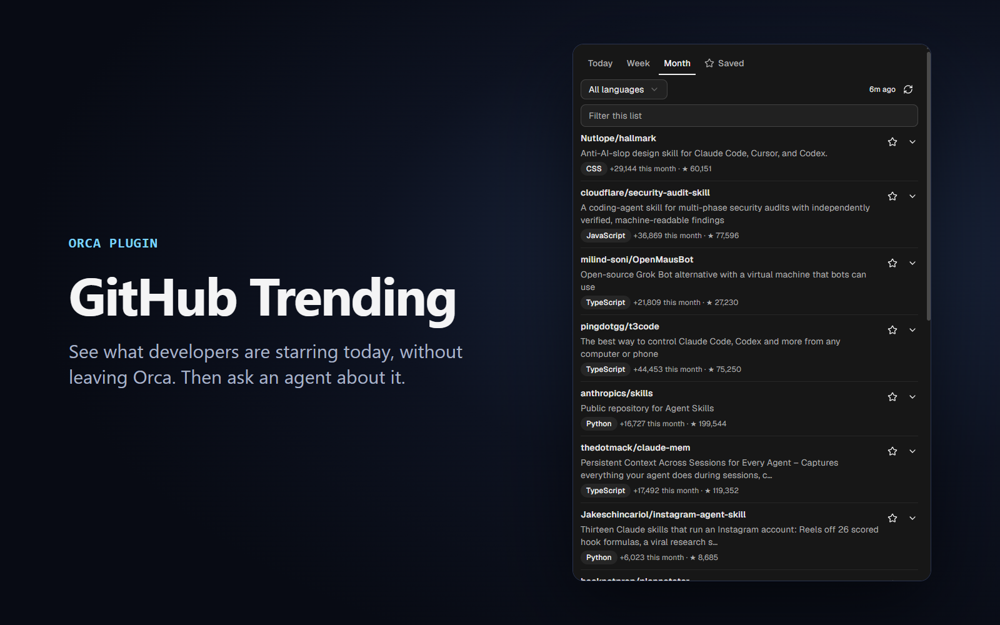

# GitHub Trending for Orca

Discover trending GitHub repositories without leaving [Orca](https://orca.dev). Explore what's popular today, this week or this month, filter by language, and save projects to revisit later. Then put an agent on one.

- **Try in a workspace** creates a new workspace in one of your projects and starts an agent there to evaluate the repository for it.
- **Usage ideas:** expand a supported repository for a concrete use case, a small experiment and a link to the upstream docs. Ideas are curated from public sources; they are not installed or executed.
- **Trending history** on all-language lists shows when the public tracker first saw a project today or saw it on consecutive UTC days across any period. These are observations, not a repository's age or a change in rank. If today's snapshot isn't available, you still get GitHub's live list.
- **Match workspace** shows trending repositories for your workspace's language and follows you when you switch.
- **Saved** keeps the repositories you star in the panel.
- A **status bar item** shows today's top repository; press it to show or hide the side panel.
- Commands: "GitHub Trending: Refresh" and "GitHub Trending: Show or hide side panel".

Requires Orca 1.4.259 or later.

## Try in a workspace

Try in a workspace first shows what they will do, and nothing starts until you press Create workspace. It uses your own agent account. Choose the agent (Claude Code, Codex or Gemini) under the plugin in Orca's Settings.

The prompt contains only the repository's address. The agent is told to treat the repository as untrusted content, not to run or install it, and not to change files.

## Access it asks for

- **Runs its own code (full access).** A panel cannot use the network, so a worker reads `github.com/trending` (GitHub has no trending API). While the plugin is enabled the worker stays running and reads that page every 30 minutes for the status bar item.
- **Read your workspaces.** To find the folder of the focused workspace and look for marker files such as `package.json` or `Cargo.toml`, and to list your projects for Try in a workspace.
- **Start agents** and **create workspaces.** Only when you confirm Try in a workspace.
- **Its own settings.** The agent choice.

The all-language panel and CLI also read a fixed public snapshot from `https://cplog.github.io/trending/data.json`. Expanding a row reads `https://cplog.github.io/trending/insights.json`. Matching happens locally: neither request includes a repository name, workspace, language, saved list or vault data.

## For agents and scripts

Orca does not yet let agents call a plugin. Until it does, this prints the same list as JSON:

```
node cli.mjs [daily|weekly|monthly] [language]
```

## Develop

```
orca plugin test .         # panel and worker tests; one reads github.com/trending live
orca plugin check .        # renders the scenarios in panel/panel.check.ts
orca plugin dev load .
```
